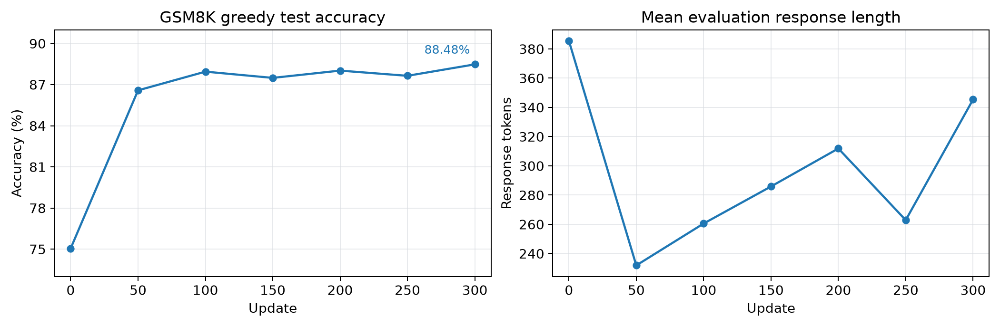
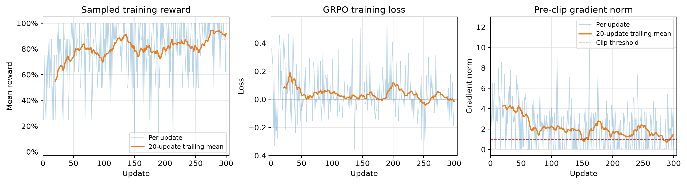
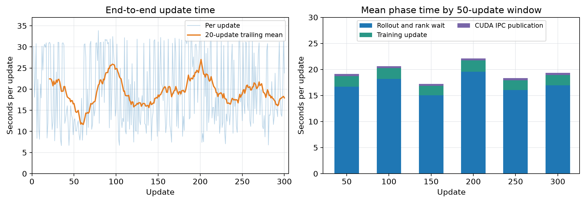

# Qwen3.5-4B-Base GRPO Training Results on Dual H20

Direct GRPO on GSM8K raised greedy test accuracy from **75.06% (990/1,319)** to
**88.48% (1,167/1,319)** in **300 optimizer updates**, a gain of **13.42
percentage points**. Step 300 was the highest-scoring saved checkpoint and was
evaluated after reloading the exported weights. The run used GPU AdamW, FSDP2,
and CUDA IPC weight publication to two rank-local vLLM replicas.

## Model and Dataset Size

| Property | Value |
| --- | --- |
| Initialization | Qwen/Qwen3.5-4B-Base, direct GRPO |
| Training data | 600 distinct questions from the 7,473-question GSM8K training split, shuffled with seed 42 |
| Test data | Full GSM8K main test split, 1,319 questions with zero exact question overlap with training |
| Prompt | `Question: {question}\nAnswer:` |
| Generation budget | Up to 1,024 new tokens per answer for both rollout and evaluation |
| Reward and grading | Exact numeric match on the last number after the final `####` marker, or the last number in the response when the marker is absent |

## Experimental Design and Training Budget

| Property | Value |
| --- | --- |
| Hardware | 2 × NVIDIA H20 96 GB, connected by NVLink |
| Training | FSDP2 with BF16 compute and activation checkpointing |
| Optimizer | GPU AdamW, constant learning rate 1e-6, weight decay 0, gradient clipping threshold 1.0 |
| Questions and samples per update | 1 question per rank, 4 sampled answers per question, 8 answers across both ranks |
| Gradient accumulation | 1, with one optimizer update per fresh rollout batch |
| Total training rollouts | 2,400 sampled answers from 600 questions |
| GRPO objective | Ratio clipping at 0.2 and KL coefficient 0.01 against the frozen Base reference |
| vLLM rollout | vLLM 0.26.0, BF16, eager execution, one TP=1 replica per rank, up to 4 concurrent answers per replica |
| Rollout sampling | Temperature 1.0, top-p 1.0 |
| Evaluation | Greedy decoding on all 1,319 test questions at Base and updates 50, 100, 150, 200, 250, and 300 |

A separate 12-update pilot set the training budget. The formal run started again
from Base, exported model weights every 50 updates, and evaluated the six exports
after training.

## Test Results

| Update | Correct / 1,319 | Accuracy | Mean response tokens | Responses stopped at 1,024 tokens |
| ---: | ---: | ---: | ---: | ---: |
| 0, Base | 990 | 75.06% | 385.41 | 183 |
| 50 | 1,142 | 86.58% | 231.91 | 12 |
| 100 | 1,160 | 87.95% | 260.55 | 13 |
| 150 | 1,154 | 87.49% | 285.89 | 21 |
| 200 | 1,161 | 88.02% | 311.87 | 38 |
| 250 | 1,156 | 87.64% | 262.88 | 18 |
| **300, best** | **1,167** | **88.48%** | **345.39** | **48** |

Step 300 solved **232** questions that Base missed and missed **55** that Base
solved, for a net gain of **177**. Its mean response was about 40 tokens shorter
than Base, with 135 fewer responses stopped at the length limit. The checkpoint
scores are observations from one seed on the same test split.

## Training Reward and Update Diagnostics

| Update window | Sampled training reward | Mean GRPO loss | Mean pre-clip gradient norm |
| --- | ---: | ---: | ---: |
| 1–50 | 66.75% | 0.08224 | 3.983 |
| 51–100 | 77.00% | 0.04211 | 2.056 |
| 101–150 | 83.25% | 0.02264 | 1.671 |
| 151–200 | 80.00% | 0.05201 | 2.058 |
| 201–250 | 83.75% | 0.01223 | 1.701 |
| 251–300 | 89.25% | 0.00888 | 1.392 |

Overall, **1,920 / 2,400** sampled training answers received reward 1, and **171 /
300** updates exceeded the gradient clipping threshold. The GRPO loss uses freshly
sampled answers and can have either sign. Its 50-update mean rose in updates 151–200
even as test accuracy recovered from 87.49% at update 150 to 88.02% at update 200.
The plots show individual updates with a 20-update trailing mean.

## Runtime and Memory

| Measurement | Result |
| --- | ---: |
| Trainer wall time, including checkpoint exports | **1 h 39 min 35 s** |
| Update time, mean / median / P95 | **19.46 / 16.89 / 31.77 s** |
| Rollout until both ranks were ready, mean | **17.09 s**, 87.80% of update time |
| Training update, mean | 1.98 s |
| AdamW step within the training update, mean | 0.058 s |
| CUDA IPC weight publication, mean / P95 | **0.394 / 0.423 s** |
| Checkpoint export, range across six checkpoints | 18.31–19.72 s |
| Peak PyTorch allocated memory in the trainer, maximum across ranks | **46.04 GiB** |
| Rollout output throughput across both ranks | 146.35 tokens/s over the measured rollout time |
| Standalone Base evaluation throughput on one H20 | 2,330.12 output tokens/s with up to 96 concurrent requests |

The profile uses **299 post-warmup updates**. Timings are host wall-clock
measurements. Rollout includes waiting for the slower rank, the training update
includes the policy and reference passes, backpropagation and AdamW, and
checkpoint export is timed separately. The trainer memory peak is PyTorch
allocated memory in the training processes.

The longest responses govern the rollout barrier. The 4-answer limit on each
training replica gives a different workload from the standalone greedy
evaluation, which queues all test questions with up to 96 concurrent requests
on one GPU. The throughput figures describe those two workloads on the same H20
node.

